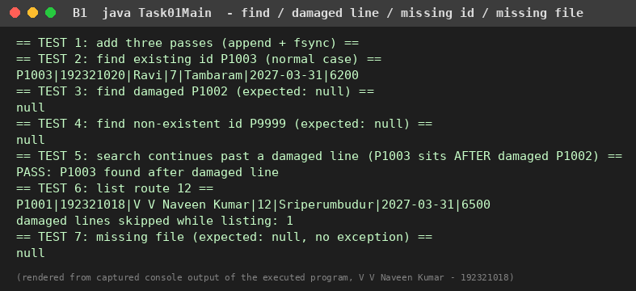
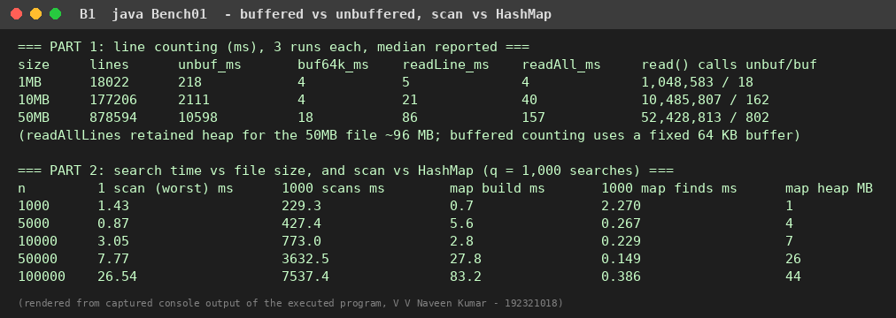

# Task 01 (B1) – Bus-Pass File Store

**Files:** `src/PassRecord.java`, `src/PassStore.java` (**TODO 1 completed in `find()`**), `src/LineCounter.java`, `src/Task01Main.java`, `src/Bench01.java` · `out/` console output · `results/*.csv` measurements.

```
javac -d classes src/*.java
java -cp classes Task01Main          # functional tests
java -Xmx1g -cp classes Bench01      # measurements (≈ 1 min)
```

## 1. Functional tests (`out/task01_functional_tests.txt`)
| # | Test | Expected | Actual |
|---|------|----------|--------|
| 1 | add 3 passes (P1002 written damaged by hand: 5 fields) | no error | ✔ |
| 2 | `find("P1003")` normal | P1003 record | `P1003\|192321020\|Ravi\|7\|Tambaram\|2027-03-31\|6200` ✔ |
| 3 | `find("P1002")` damaged line | `null` | `null` ✔ |
| 4 | `find("P9999")` non-existent | `null` | `null` ✔ |
| 5 | P1003 is stored **after** damaged P1002 | still found | ✔ search continues |
| 6 | `listByRoute("12")` | P1001, 1 damaged skipped | ✔ |
| 7 | missing file | `null`, no exception | ✔ |

Matches the expected output in the brief (P1003 record, then `null` for the damaged P1002 line).

**Comparison with Part A pseudocode:** the Java is a line-by-line translation of `FindPass`/`ParseLine`/`AddPass`/`ListByRoute`. One addition made while coding: `add()` calls `FileDescriptor.sync()` (pseudocode step 7), and `parse()` uses `split("\\|", -1)` – the `-1` is essential, otherwise a trailing empty field is dropped and a 6-field line with an empty last field looks like a short line.

## 2. Why a damaged line does not stop the search
`PassRecord.parse()` never throws: it returns `null` for a wrong field count, non-numeric amount, empty line or blank key (the `NumberFormatException` is caught inside). `find()` treats `null` as "skip and read the next line". Lines are independent (newline-framed), so damage in one line cannot shift or hide the next.

## 3. Line counting, buffered vs unbuffered (`results/line_counting.csv`, median of 3 runs)
| Size | Lines | Unbuffered `read()` | 64 KB buffer | `BufferedReader` | `readAllLines` | read() calls (unbuf / buf) |
|------|-------|--------------------|--------------|------------------|----------------|-----------------------------|
| 1 MB | 18,022 | 218 ms | 4 ms | 5 ms | 4 ms | 1,048,583 / 18 |
| 10 MB | 177,206 | 2,111 ms | 4 ms | 21 ms | 40 ms | 10,485,807 / 162 |
| 50 MB | 878,594 | **10,598 ms** | **18 ms** | 86 ms | 157 ms | 52,428,813 / 802 |

**Interpretation:** time for the unbuffered version grows linearly with bytes (≈ 0.2 µs per call) and is **≈ 590× slower** at 50 MB; the call count matches the prediction in A2 (bytes ÷ 65,536 for the buffered version). `readAllLines` is fast but retained ≈ 96 MB of heap for the 50 MB file; the buffered counter uses a constant 64 KB.

## 4. Search time as the file grows (`results/search_scaling.csv`; q = 1,000 searches)
| n passes | 1 scan, worst case | 1,000 scans | HashMap build | 1,000 map lookups | map heap |
|---------|--------------------|-------------|---------------|-------------------|----------|
| 1,000 | 1.4 ms | 229 ms | 0.7 ms | 2.3 ms | 1 MB |
| 5,000 | 0.9 ms | 427 ms | 5.6 ms | 0.3 ms | 4 MB |
| 10,000 | 3.1 ms | 773 ms | 2.8 ms | 0.2 ms | 7 MB |
| 50,000 | 7.8 ms | 3,633 ms | 27.8 ms | 0.15 ms | 26 MB |
| 100,000 | 26.5 ms | **7,537 ms** | 83.2 ms | 0.4 ms | 44 MB |

(The very first row, 1.4 ms for 1,000 records, is JIT warm-up noise; the trend from 5,000 upward is linear.)

## 5. Alternative design: scan every time vs load into a `HashMap`
* **Why scanning is O(n) per find:** every `find()` re-reads and re-parses lines from the top. With *q* searches on *n* passes: **O(q × n)** time. Measured: 1,000 searches on 100,000 passes = 7.5 s (≈ 7.5 ms each, growing linearly with *n*).
* **HashMap:** read the file once to build the map – O(n) – and each lookup is O(1) average: **O(n + q)**. Measured: build 83 ms + 1,000 lookups 0.4 ms ≈ **90× faster** for this workload. Break-even: building the map costs about as much as 11 scans at n = 100,000 (83 ms ÷ ≈ 7.5 ms per scan), so the map wins from q ≈ 11 searches.
* **Memory:** scan-based uses **O(1)** memory (one line + 8 KB buffer). HashMap uses **O(n)**: ≈ 0.4 KB per record in Java (44 MB per 100,000, 307 MB for 800,000 in Task04) because every record is a `PassRecord` object plus six `String` objects.
* **Staleness:** the map must be refreshed (or updated on `add()`) when the file changes; the scan always sees the latest file.
* **Decision:** for one lookup per program run, scan; for many lookups in one run (nightly job, a counter application that keeps running), use the HashMap – cost O(n) memory.

## Evidence (output captures)


