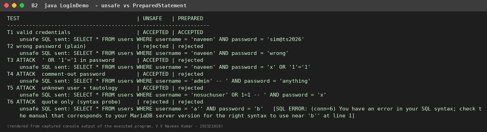
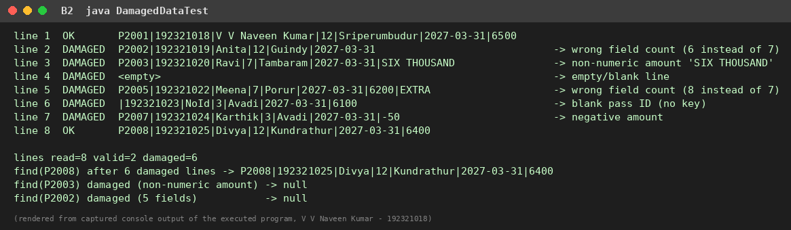

# Task 02 (B2) – Adversarial Input

**Files:** `sql/01_create_login_db.sql` (local test DB `csa09_assignment5`, table `users`), `src/LoginDemo.java` (unsafe + PreparedStatement), `src/DamagedDataTest.java`, `data/damaged_passes.txt`, `out/*.txt`.

```
mysql -u root < sql/01_create_login_db.sql
javac -cp ../Task01/classes:<jdbc-driver.jar> -d classes src/*.java
java -cp classes:../Task01/classes:<jdbc-driver.jar> LoginDemo
java -cp classes:../Task01/classes DamagedDataTest
```

## 1. Login tests (`out/task02_login_test.txt`)
| Test | Username / Password | Unsafe (concatenation) | PreparedStatement |
|------|--------------------|------------------------|-------------------|
| T1 valid | `naveen` / `sim@ts2026` | ACCEPTED ✔ | ACCEPTED ✔ |
| T2 wrong password | `naveen` / `wrong` | rejected ✔ | rejected ✔ |
| T3 **attack** | `naveen` / `x' OR '1'='1` | **ACCEPTED ✘** | rejected ✔ |
| T4 **attack** | `admin' -- ` / `anything` | **ACCEPTED ✘** | rejected ✔ |
| T5 **attack** | `nosuchuser' OR 1=1 -- ` / `x` | **ACCEPTED ✘** (user does not exist!) | rejected ✔ |
| T6 syntax probe | `a'` / `b` | SQL syntax error (leaks DB error text) | rejected ✔ |

SQL actually sent for T3: `SELECT * FROM users WHERE username = 'naveen' AND password = 'x' OR '1'='1'`
**Explanation:** the quote closes the string literal; `OR '1'='1'` is always true. T4 uses `-- ` to comment out the password test. T6 shows an attacker can learn that the input reaches the SQL parser (error messages should never be shown to users). With `PreparedStatement` the SQL is compiled first and the two values are sent as data, so `x' OR '1'='1` is just a wrong password string.

## 2. Damaged bus-pass data (`data/damaged_passes.txt`, `out/task02_damaged_data.txt`)
| Line | Input | Result | What it reveals about the original design |
|------|-------|--------|-------------------------------------------|
| 2 | 6 fields instead of 7 | rejected: wrong field count | A reader that does `fields[6]` without checking the count would throw `ArrayIndexOutOfBoundsException` and kill the whole search. Field count must be validated first. |
| 3 | amount `SIX THOUSAND` | rejected: non-numeric amount | `Integer.parseInt` throws; the exception must be caught per line, not per file. |
| 4 | empty line | rejected: empty line | `split` of "" gives 1 field – must be detected explicitly (also happens with a trailing blank line after a crash). |
| 5 | 8 fields (extra `|EXTRA`) | rejected: wrong field count | A name containing `|` would look like this – the delimiter must be forbidden in data or escaped. |
| 6 | blank pass ID | rejected: blank key | A record without a key can never be found; it must not enter the store. |
| 7 | amount `-50` | rejected: negative amount | Type check alone (`int`) is not enough; business rules (≥ 0) are also needed. |
Result: 8 lines read, **2 valid, 6 damaged**; `find("P2008")` still returns the valid record that sits *after* all the damaged lines, and `find` of any damaged ID returns `null`.
**Design lesson:** the text format has no built-in integrity check, so *every read* must validate; a CRC (binary design in A1) or a database with constraints (`NOT NULL`, `CHECK`, types) pushes this check to the storage layer.

## Evidence (output captures)


