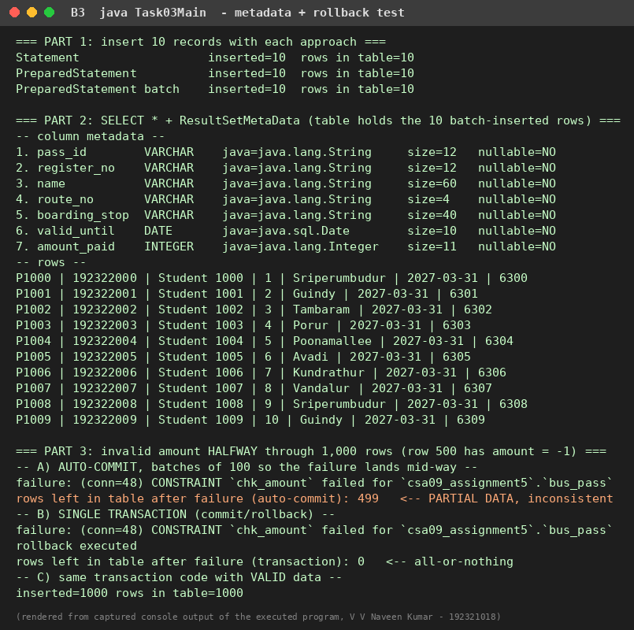
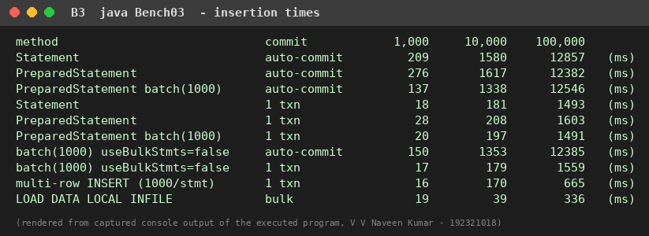
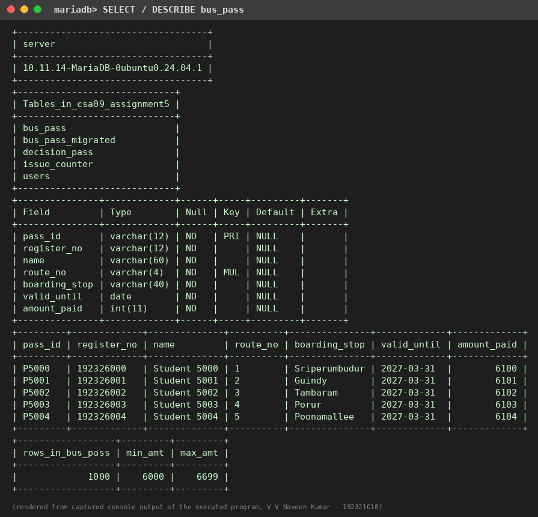

# Task 03 (B3) – JDBC Performance Comparison

**Files:** `sql/01_create_bus_pass.sql`, `src/PassLoader.java` (**TODO 1, 2, 3 completed**: `insertWithStatement`, `insertWithPrepared`, `insertWithBatch` – batches of 1,000), `src/Task03Main.java`, `src/Bench03.java`, `out/`, `results/jdbc_insert_times.csv`.

**Environment:** MariaDB 10.11.14 (MySQL-compatible) with MariaDB Connector/J 2.7.6, local database `csa09_assignment5`. Connection URL pattern: `jdbc:mariadb://localhost:3306/csa09_assignment5`. *(To run on Oracle MySQL replace the URL by `jdbc:mysql://...` and use MySQL Connector/J – the SQL and Java code are unchanged; see "Honest limits" below.)*

```
mysql -u root < sql/01_create_bus_pass.sql
java -cp classes:../Task01/classes:<driver.jar> Task03Main     # 10-row test, metadata, rollback test
java -cp classes:../Task01/classes:<driver.jar> Bench03        # timings (≈ 2 min)
```

## 1. 10 records with each approach (`out/task03_functional.txt`)
Statement, PreparedStatement and batch each inserted 10 rows; `SELECT COUNT(*)` = 10 each time.

## 2. Table contents and column types (`ResultSetMetaData`)
| # | Column | SQL type | Java class | Size | Nullable |
|---|--------|----------|-----------|------|----------|
| 1 | pass_id | VARCHAR | String | 12 | NO |
| 2 | register_no | VARCHAR | String | 12 | NO |
| 3 | name | VARCHAR | String | 60 | NO |
| 4 | route_no | VARCHAR | String | 4 | NO |
| 5 | boarding_stop | VARCHAR | String | 40 | NO |
| 6 | valid_until | DATE | java.sql.Date | 10 | NO |
| 7 | amount_paid | INTEGER | Integer | 11 | NO |

## 3. Insertion times in milliseconds (`results/jdbc_insert_times.csv`)
| Method | Commit mode | 1,000 | 10,000 | 100,000 |
|--------|-------------|------:|-------:|--------:|
| Statement | auto-commit | 209 | 1,580 | 12,857 |
| PreparedStatement | auto-commit | 276 | 1,617 | 12,382 |
| PreparedStatement batch (1,000) | auto-commit | 137 | 1,338 | 12,546 |
| Statement | 1 transaction | 18 | 181 | 1,493 |
| PreparedStatement | 1 transaction | 28 | 208 | 1,603 |
| PreparedStatement batch (1,000) | 1 transaction | 20 | 197 | 1,491 |
| batch, `useBulkStmts=false` | auto-commit / 1 txn | 150 / 17 | 1,353 / 179 | 12,385 / 1,559 |
| multi-row INSERT (1,000 rows/stmt) | 1 transaction | 16 | 170 | **665** |
| `LOAD DATA LOCAL INFILE` | server bulk load | 19 | 39 | **336** |

## 4. Interpretation – what the numbers say
1. **Commit strategy dominates, not Statement vs PreparedStatement.** In auto-commit mode every row is a separate transaction that forces a log write to disk (≈ 0.12 ms per row), so all three methods cost ≈ 12.5 s for 100,000 rows. Wrapping the same work in **one transaction cut the time ≈ 8×** (12.4 s → 1.6 s).
2. **Statement vs PreparedStatement:** in these runs they are within measurement noise (1.49 s vs 1.60 s in a transaction). The advantages of `PreparedStatement` here are **safety** (no SQL injection, correct quoting of names like `O'Neil`) and avoiding re-parsing in a long-lived connection – not raw speed on a local server.
3. **Batch processing:** with this MariaDB driver and auto-commit, batch was only marginally faster than row-by-row (12.5 s vs 12.4 s), because the log flush at every commit is the bottleneck and the network is a local socket. Batching helps most when each round trip is expensive (remote server) – I could not test that here. Combined with a transaction it is the right tool because it limits both round trips and commits.
4. **Multi-row INSERT** reduced 100,000 rows to 0.67 s (≈ 2.2× faster than batching) because the server parses 100 statements instead of 100,000. **LOAD DATA** was fastest at 0.34 s (≈ 4.4× faster than batching) because it skips SQL parsing per row, but needs a file, `local_infile` permission and does its own error handling.

## 5. Transaction failure test (`out/task03_functional.txt`, Part 3)
1,000 passes, with an invalid amount (`-1`, violates `CHECK (amount_paid >= 0)`) at row 500.
| Mode | Result | Rows left in table |
|------|--------|-------------------:|
| Auto-commit (batches of 100) | exception at row 500 | **499** – partial, inconsistent data |
| One transaction (`commit` / `rollback`) | exception, rollback executed | **0** – all-or-nothing |
| Same transaction code, valid data | commit | 1,000 |

## 6. Recommendations
* **Nightly import of 100,000 passes:** one transaction + `PreparedStatement` batches of 1,000 (≈ 1.5 s here), or LOAD DATA if the file is trusted and the DB user has the permission. Validate first and report rejects (Task04 does this).
* **One pass at the counter:** a single `PreparedStatement` `INSERT` in auto-commit (one row = one transaction, ≈ 0.12 ms); batching has nothing to batch. Use an explicit transaction only if several tables change together (e.g. pass + payment).
* **Batch vs multi-row INSERT vs LOAD DATA:** batch = portable, safe, per-row error information; multi-row INSERT = faster, but statement size limited by `max_allowed_packet` and one bad row fails the statement; LOAD DATA = fastest, least control.

## Honest limits
Results come from a MariaDB server on the same machine; absolute numbers will differ on Oracle MySQL and on a remote server. The Oracle MySQL Connector/J has `rewriteBatchedStatements=true` which should make batches much faster than shown; I did not test that driver.

## Evidence (output captures)



