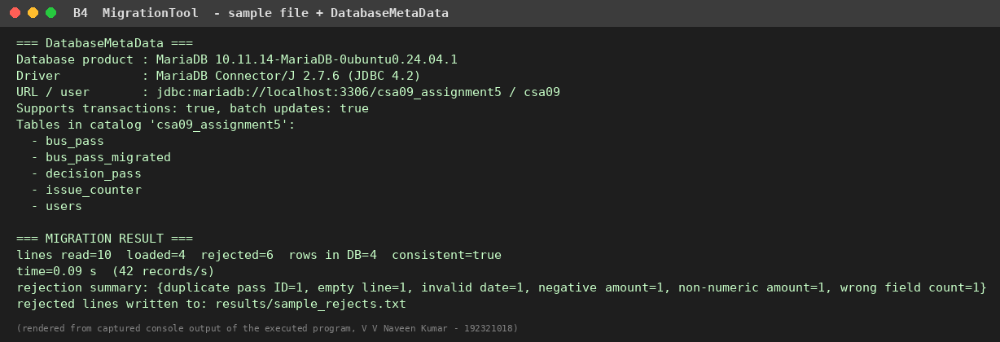
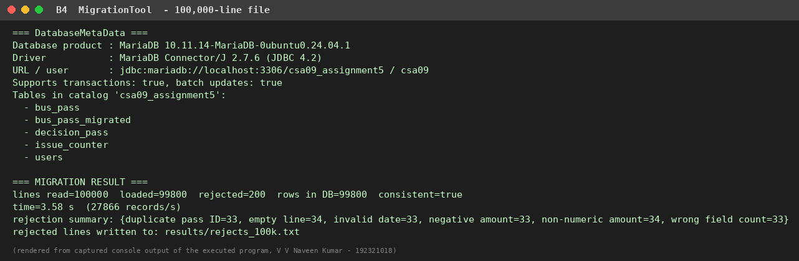
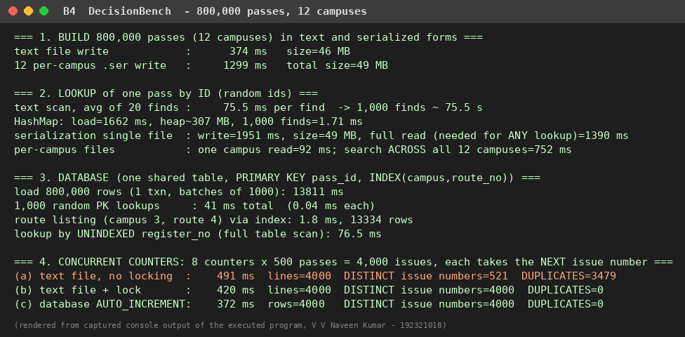
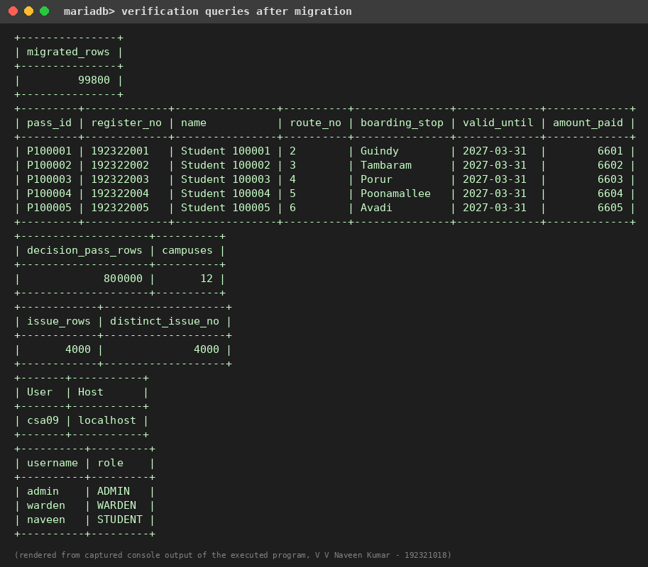

# Task 04 (B4) – Final Engineering Decision

**Files:** `src/MigrationTool.java` (batches of 1,000, one transaction, validation report, `DatabaseMetaData`), `src/PassValidator.java`, `src/GenerateInput.java`, `src/DecisionBench.java`, `sql/01_create_migration_tables.sql`, `data/sample_migration_input.txt`, `results/`, `out/`.

```
mysql -u root < sql/01_create_migration_tables.sql
java -cp classes:../Task01/classes:../Task03/classes:<driver.jar> MigrationTool data/sample_migration_input.txt results/sample_rejects.txt
java -cp ... GenerateInput 100000 500 data/migration_100k.txt
java -cp ... MigrationTool data/migration_100k.txt results/rejects_100k.txt
java -Xmx1800m -cp ... DecisionBench
```

## 1. Migration results
| Run | Lines | Loaded | Rejected | Rows in DB | Time |
|-----|------:|-------:|---------:|-----------:|-----:|
| Sample file | 10 | 4 | 6 | 4 | 0.09 s |
| 100,000-line file (200 injected defects) | 100,000 | 99,800 | 200 | 99,800 | 3.58 s (27,866 rec/s) |
`loaded + rejected = lines read` and `rows in DB = loaded` in both runs. Rejection reasons (100k run): duplicate ID 33, empty line 34, invalid date 33, negative amount 33, non-numeric amount 34, wrong field count 33 – exactly the injected defects; each rejected line is written with its line number and reason to `results/rejects_100k.txt`.
`DatabaseMetaData` report: product **MariaDB 10.11.14**, driver **MariaDB Connector/J 2.7.6 (JDBC 4.2)**, tables `bus_pass, bus_pass_migrated, decision_pass, issue_counter, users` (see `out/task04_migration_100k.txt`).

## 2. Scale test: 12 campuses, 100 × passes = 800,000 (`out/task04_decision_bench.txt`)
| Measurement | Text file | Serialization | Database (shared) |
|-------------|----------|---------------|-------------------|
| Size on disk | 46 MB | 49 MB (12 files) | – |
| Find one pass by ID | **75.5 ms** (scan) | **1,390 ms** (whole single file must be deserialized) / 92 ms one campus / **752 ms** across all 12 campus files | **0.04 ms** (PK index) |
| 1,000 finds | ≈ 75 s | – | **41 ms** |
| Same lookups after loading to memory | HashMap: load 1.66 s, **307 MB heap**, 1,000 finds 1.7 ms | – | – |
| Route listing (campus 3, route 4 – 13,334 rows) | full scan | full read | **1.8 ms** (index) |
| Load 800,000 records | – | 1.3–1.9 s to write | 13.8 s (one transaction, batches of 1,000) |
| Lookup by an unindexed column | scan | scan | 76.5 ms (full table scan – index matters) |

## 3. Concurrent counters (8 counters × 500 issues = 4,000 numbered passes)
| Approach | Time | Distinct issue numbers | Duplicates |
|----------|-----:|----------------------:|-----------:|
| Text file, "read last number then append", no locking | 491 ms | 521 | **3,479 (87 % wrong)** |
| Same with a mutual-exclusion lock | 420 ms | 4,000 | 0 |
| Database `AUTO_INCREMENT` primary key, 8 connections | 372 ms | 4,000 | 0 |
*(The unsafe version contains a `Thread.yield()` between "read" and "write" to model the real latency of a counter terminal; without a coordinating mechanism the lost-update race is inherent.)* A lock inside one JVM does not protect separate counter computers/processes; a file would then need OS-level `FileLock`, which is unreliable on network shares. The database gives correct numbering to any number of clients by design.

## 4. Decision for the expanded system
**Use a relational database (one shared MySQL/MariaDB database).**
| Requirement | Text files | Serialization | Database | Evidence |
|-------------|-----------|---------------|----------|----------|
| **Concurrent counters** | ✘ duplicates / needs locks | ✘ whole-object rewrite, last writer wins | ✔ transactions + unique keys | 3,479 duplicates vs 0 |
| **Searching** | O(n) scan, 75 ms | must load everything (1.4 s) | O(log n) index, 0.04 ms | 1,800× faster than scan |
| **Safety** | no integrity checks, partial writes | version/`serialVersionUID` fragility, deserialization security risk | ACID, `CHECK`/`NOT NULL`/PK, rollback | Task03: 0 rows after rollback vs 499 partial |
| Scale / memory | O(1) memory per scan but slow; HashMap needs 307 MB per process | whole graph in memory | server manages memory/disk | |
| Backup/audit | copy files | copy files | dump, replication, user accounts | |
Text files remain right for **import/export and archive** (the migration input), serialization for **caching a small object graph** in one application – not for the shared system.

## 5. One shared database vs separate serialized file per campus
| | One shared database | 12 serialized files |
|---|---|---|
| Find a pass without knowing the campus | one indexed query, 0.04 ms | read up to 12 files: **752 ms** (≈ 19,000× slower) |
| Cross-campus report | one `GROUP BY` | load and merge 12 files |
| Consistency | one set of rules / constraints | 12 copies of the logic and schema (UID changes must be rolled out to every file) |
| Concurrent writers | row-level locking | 12 independent single-writer files, each still unsafe |
| Isolation of failure | single point of failure → needs backup / replication | one corrupt file affects one campus only |
| Cost / operation | needs a server and an administrator | no server |
Per-campus files are acceptable only for fully independent, offline campuses; the requirement (searching and concurrent counters across 12 campuses) points to the shared database, with per-campus data distinguished by the `campus` column and index.

## Evidence (output captures)




